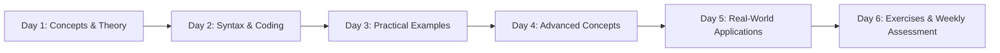

<div align="center">

# 🚀 Python for AI & Machine Learning: Complete Course

### *A Comprehensive 24-Week (144-Hour) Journey from Zero to Advanced AI/ML Engineering*

[](https://www.python.org/)
[](00-COURSE-OVERVIEW/)
[](LICENSE)
[](15-WEEKLY-LESSON-PLANS/)
[](CONTRIBUTING.md)

[**Explore Syllabus**](00-COURSE-OVERVIEW/) • [**Weekly Lesson Plans**](15-WEEKLY-LESSON-PLANS/) • [**Projects**](10-PRACTICAL-PROJECTS/) • [**Assessments**](11-ASSIGNMENTS-AND-ASSESSMENTS/) • [**Interview Prep**](12-INTERVIEW-PREPARATION/)

</div>

---

## 📌 Course Highlights

This repository contains the complete curriculum, lesson plans, assignments, and architecture for an intensive **144-hour industrial Python for AI/ML program**. Designed for absolute beginners as well as developers looking to transition into Artificial Intelligence, this course bridges computer science fundamentals, mathematical intuition, modern machine learning algorithms, deep learning architectures, Generative AI (LLMs, RAG, AI Agents), and end-to-end MLOps deployment.

| Metric | Details |
| :--- | :--- |
| **Duration** | **24 Weeks** |
| **Intensity** | **6 Days / Week** (Monday through Saturday) |
| **Class Length** | **1 Hour / Day** |
| **Weekly Total** | **6 Hours / Week** |
| **Total Program** | **144 Instructional Hours** |
| **Primary Languages & Tools** | Python 3.10+, NumPy, Pandas, Matplotlib, Seaborn, Scikit-learn, TensorFlow, Keras, PyTorch, LangChain, ChromaDB, FastAPI, Streamlit, Docker |

---

## 🔄 The 6-Day Teaching & Assessment Pedagogy

Every single week follows an active-learning instructional cycle ensuring concepts are turned into practical code and verified through rigorous evaluation:



| Day | Teaching Approach | Instructional Focus |
| :---: | :--- | :--- |
| **Day 1** | **Concepts and theory** | Intuition, mathematical principles, architectural mental models, and Q&A |
| **Day 2** | **Syntax and coding** | Core language constructs, library signatures, parameters, and live coding |
| **Day 3** | **Practical examples** | Guided code-alongs, step-by-step problem scenarios, and troubleshooting |
| **Day 4** | **Advanced concepts** | Edge cases, algorithmic complexity, optimization, and internal mechanics |
| **Day 5** | **Real-world applications** | Production mini-projects, industry datasets, pipelines, and best practices |
| **Day 6** | **Exercises & assessment** | Independent coding challenges, weekly timed quizzes, code reviews, and grading |

---

## 🗺️ Curriculum Roadmap (10 Phases & 24 Weeks)

```
Phase 1: Python Fundamentals (W1-4)       ──► Phase 2: Intermediate Python (W5-7)
Phase 3: Mathematics for AI/ML (W8-9)     ──► Phase 4: Data Analytics & EDA (W10-12)
Phase 5: ML Fundamentals (W13-16)         ──► Phase 6: Advanced ML & Optimization (W17-18)
Phase 7: Deep Learning (W19-20)           ──► Phase 8: Generative AI & LLMs (W21-22)
Phase 9: Deployment & MLOps (W23)         ──► Phase 10: Capstone Project (W24)
```

### Phase Breakdown & Quick Navigation

| Phase | Weeks | Focus Topics | Lesson Plans |
| :--- | :---: | :--- | :---: |
| **Phase 1: Python Fundamentals** | W01 – W04 | Syntax, Variables, Data Types, Control Flow, Loops, Sequences, Dictionaries | [Week 01](15-WEEKLY-LESSON-PLANS/Week-01/) • [Week 02](15-WEEKLY-LESSON-PLANS/Week-02/) • [Week 03](15-WEEKLY-LESSON-PLANS/Week-03/) • [Week 04](15-WEEKLY-LESSON-PLANS/Week-04/) |
| **Phase 2: Intermediate Python** | W05 – W07 | Functions, Recursion, Lambdas, Modules, File I/O, Exceptions, OOP, Design Patterns | [Week 05](15-WEEKLY-LESSON-PLANS/Week-05/) • [Week 06](15-WEEKLY-LESSON-PLANS/Week-06/) • [Week 07](15-WEEKLY-LESSON-PLANS/Week-07/) |
| **Phase 3: Mathematics for AI/ML** | W08 – W09 | Linear Algebra, Vectors, Matrices, Statistics, Probability Distributions, Calculus, Gradient Descent | [Week 08](15-WEEKLY-LESSON-PLANS/Week-08/) • [Week 09](15-WEEKLY-LESSON-PLANS/Week-09/) |
| **Phase 4: Data Analytics & EDA** | W10 – W12 | NumPy Array Computing, Pandas Data Wrangling, Matplotlib, Seaborn Visualization, EDA | [Week 10](15-WEEKLY-LESSON-PLANS/Week-10/) • [Week 11](15-WEEKLY-LESSON-PLANS/Week-11/) • [Week 12](15-WEEKLY-LESSON-PLANS/Week-12/) |
| **Phase 5: Machine Learning Fundamentals** | W13 – W16 | Supervised Learning, Linear/Logistic Regression, Decision Trees, Random Forest, KNN, SVM, Clustering, PCA | [Week 13](15-WEEKLY-LESSON-PLANS/Week-13/) • [Week 14](15-WEEKLY-LESSON-PLANS/Week-14/) • [Week 15](15-WEEKLY-LESSON-PLANS/Week-15/) • [Week 16](15-WEEKLY-LESSON-PLANS/Week-16/) |
| **Phase 6: Advanced Machine Learning** | W17 – W18 | Scikit-learn Pipelines, Feature Engineering, Feature Selection, Cross-Validation, Tuning, Regularization | [Week 17](15-WEEKLY-LESSON-PLANS/Week-17/) • [Week 18](15-WEEKLY-LESSON-PLANS/Week-18/) |
| **Phase 7: Deep Learning** | W19 – W20 | Perceptrons, Backpropagation, Optimizers, TensorFlow, Keras, PyTorch, CNNs, RNNs, Transfer Learning | [Week 19](15-WEEKLY-LESSON-PLANS/Week-19/) • [Week 20](15-WEEKLY-LESSON-PLANS/Week-20/) |
| **Phase 8: Generative AI and LLMs** | W21 – W22 | Transformers, Self-Attention, Prompt Engineering, LLM APIs, Vector Embeddings, ChromaDB, LangChain, RAG, AI Agents | [Week 21](15-WEEKLY-LESSON-PLANS/Week-21/) • [Week 22](15-WEEKLY-LESSON-PLANS/Week-22/) |
| **Phase 9: Model Deployment & MLOps** | W23 | Git/GitHub Version Control, Flask, FastAPI REST Endpoints, Streamlit Dashboards, Docker, Model Serialization, Monitoring | [Week 23](15-WEEKLY-LESSON-PLANS/Week-23/) |
| **Phase 10: Final Capstone Project** | W24 | End-to-End Applied AI System: Architecture, EDA, Modeling, Optimization, FastAPI Backend, Streamlit UI, Deployment | [Week 24](15-WEEKLY-LESSON-PLANS/Week-24/) |

👉 **Read the complete day-by-day lesson schedule in the [Course Overview](00-COURSE-OVERVIEW/README.md) and [Weekly Lesson Plans Index](15-WEEKLY-LESSON-PLANS/README.md).**

---

## 📂 Repository Directory Structure

```text
Python-for-AI-ML-Complete-Course/
│
├── 00-COURSE-OVERVIEW/               # Master syllabus, hours, learning outcomes & course philosophy
├── 01-PYTHON-FUNDAMENTALS/           # Basic syntax, data types, operators, conditionals & loops
├── 02-INTERMEDIATE-PYTHON/           # Functions, modules, exception handling, file I/O & OOP
├── 03-MATHEMATICS-FOR-AI-ML/         # Linear algebra, calculus, probability & statistics
├── 04-DATA-ANALYTICS-AND-DATA-SCIENCE/ # NumPy, Pandas, Matplotlib, Seaborn & exploratory analysis
├── 05-MACHINE-LEARNING-FUNDAMENTALS/ # Supervised, unsupervised, regression, classification & clustering
├── 06-ADVANCED-MACHINE-LEARNING/     # Pipelines, feature engineering, selection & hyperparameter tuning
├── 07-DEEP-LEARNING/                 # Neural nets, TensorFlow, PyTorch, CNNs, RNNs & transfer learning
├── 08-GENERATIVE-AI-AND-LLM/         # Transformers, Prompt Engineering, Embeddings, RAG & AI Agents
├── 09-MODEL-DEPLOYMENT-AND-MLOPS/    # Git, FastAPI, Streamlit, Docker, model tracking & cloud deployment
├── 10-PRACTICAL-PROJECTS/            # Hands-on projects from beginner scripts to end-to-end capstones
├── 11-ASSIGNMENTS-AND-ASSESSMENTS/   # Weekly coding problem sets, assessments, quizzes & answer keys
├── 12-INTERVIEW-PREPARATION/         # Topic-wise interview Q&A and coding challenge solutions
├── 13-STUDENT-TRACKING/              # Attendance, weekly performance trackers & rubrics
├── 14-STUDY-MATERIALS-AND-RESOURCES/ # PDF notes, reference guides, cheatsheets & datasets
└── 15-WEEKLY-LESSON-PLANS/           # Week-01 through Week-24 structured daily teaching plans
```

---

## ⚡ Quick Start & Environment Setup

Follow these steps to set up your local development environment:

### 1. Clone the Repository
```bash
git clone https://github.com/maheswari-pinneti/Python-for-AI-ML-Complete-Course.git
cd Python-for-AI-ML-Complete-Course
```

### 2. Create and Activate a Virtual Environment
```bash
# On Windows (PowerShell)
python -m venv .venv
.\.venv\Scripts\Activate.ps1

# On macOS / Linux
python3 -m venv .venv
source .venv/bin/activate
```

### 3. Install Core Data Science & AI Libraries
```bash
pip install --upgrade pip
pip install numpy pandas matplotlib seaborn scikit-learn
pip install jupyterlab ipykernel
```

*For Deep Learning & GenAI modules (Weeks 19–22), additional dependencies such as `torch`, `tensorflow`, `langchain`, `chromadb`, and `fastapi` are detailed within their respective module folders.*

---

## 🌿 Git Branching Structure

To maintain modularity and allow students or cohorts to focus on individual course units, each primary module is tracked on its own dedicated branch originating from `main`:

```bash
# Switch to any specific module branch:
git switch 00-COURSE-OVERVIEW
git switch 01-PYTHON-FUNDAMENTALS
git switch 02-INTERMEDIATE-PYTHON
git switch 03-MATHEMATICS-FOR-AI-ML
git switch 04-DATA-ANALYTICS-AND-DATA-SCIENCE
git switch 05-MACHINE-LEARNING-FUNDAMENTALS
git switch 06-ADVANCED-MACHINE-LEARNING
git switch 07-DEEP-LEARNING
git switch 08-GENERATIVE-AI-AND-LLM
git switch 09-MODEL-DEPLOYMENT-AND-MLOPS
git switch 10-PRACTICAL-PROJECTS
git switch 11-ASSIGNMENTS-AND-ASSESSMENTS
git switch 12-INTERVIEW-PREPARATION
git switch 13-STUDENT-TRACKING
git switch 14-STUDY-MATERIALS-AND-RESOURCES
git switch 15-WEEKLY-LESSONS-PLANS

# Return to main:
git switch main
```

---

## 🛠️ Project Portfolio & Deliverables

Throughout the 24 weeks, learners build an extensive GitHub portfolio featuring real-world applications:

1. **Python Console Projects:** Interactive financial calculators, ATM simulators, and text analyzers.
2. **Data Science & EDA:** Full Exploratory Data Analysis reports with published dashboards.
3. **Predictive ML Models:** Real estate price predictors, loan default risk classifiers, customer churn models, and customer segmentation clusters.
4. **Computer Vision & NLP:** Image classification using CNNs / Transfer Learning and sentiment analysis tools.
5. **Generative AI & RAG:** "Chat-with-your-Documents" conversational assistant powered by ChromaDB, LangChain, and modern LLM APIs.
6. **Full-Stack Capstone:** Production Machine Learning service with a FastAPI prediction endpoint, Streamlit frontend, and containerized Docker setup.

---

## 🤝 Contributing & Community Guidelines

Contributions, corrections, and extra resources are welcome!
1. Fork the Project
2. Create your Feature Branch (`git checkout -b feature/NewExercise`)
3. Commit your Changes (`git commit -m 'Add comprehensive exercise for Week 05'`)
4. Push to the Branch (`git push origin feature/NewExercise`)
5. Open a Pull Request

---

## 📄 License

This repository and course curriculum are licensed under the **[MIT License](LICENSE)** - see the LICENSE file for details.

---

<div align="center">
  <sub>Designed with ❤️ for learners, educators, and future AI/ML Engineers. Happy Coding!</sub>
</div>
